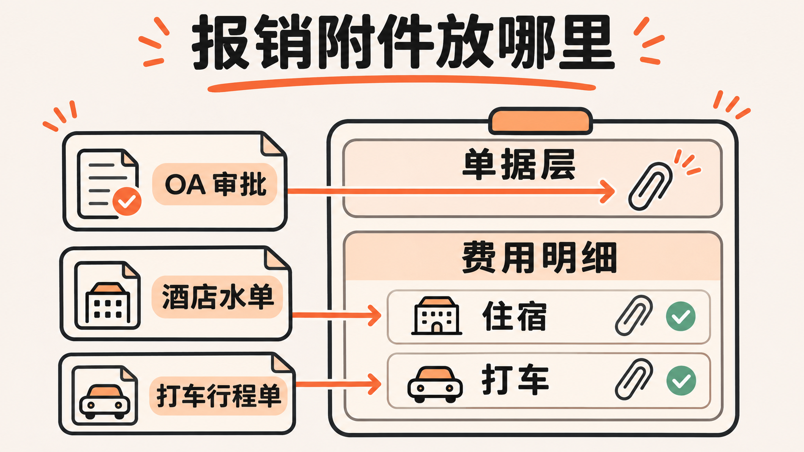

# 钉钉超级报销助手

给在钉钉「超级报销」里提差旅或日常费用报销的人用的 Codex Skill。可以先核对手里的票据和凭证，再把资料填进钉钉草稿，由你复核并提交。


[能做什么](#能做什么) · [安装](#安装) · [第一次使用](#第一次使用)

## 能做什么

| 你要做的事 | Skill 交付什么 |
| --- | --- |
| 核对报销材料 | 配对发票和行程单、酒店水单等凭证，分项出金额和缺件清单。有明确限额时按规则核算。 |
| 归档审批或查单 | 在已登录的钉钉中查找对应的 OA 审批，按需导出官方 PDF，或凭报销单号核对状态。 |
| 准备或补充报销草稿 | 先找已有草稿，按确认的表头、费用类型和附件要求填写，保存后复开同一张单核对。 |

填写钉钉草稿需要在电脑上操作已登录的客户端。操作路径以 macOS 客户端为参考，工作台入口、费用类型、字段和按钮以当前组织实际页面为准。手头只有文件时，也可以先做材料清点和填单清单。

### 报销附件放哪里



审批按组织要求在单据层关联，或上传官方 PDF。水单和行程单分别挂到对应的费用明细。这张图示意附件的归属，实际界面以钉钉客户端为准。

## 安装

1. 下载或克隆本仓库。
2. 将含有 `SKILL.md` 的整个目录放到 `~/.agents/skills/dingtalk-super-reimbursement/` 下，保留里面的 `references/` 和 `agents/`。确认 `SKILL.md` 直接位于该目录。
3. 在 Codex 中输入 `$dingtalk-super-reimbursement` 选择技能。若还没显示，重启 Codex 后再试。[Codex 技能文档](https://learn.chatgpt.com/docs/build-skills#where-codex-loads-local-skills)

也可以在终端直接安装到上述位置。

```bash
mkdir -p ~/.agents/skills
git clone https://github.com/Jiale077/dingtalk-super-reimbursement-skill.git \
  ~/.agents/skills/dingtalk-super-reimbursement
```

只核对材料时，给 Codex 票据文件或目录即可。需要导出审批、查单或填草稿时，打开已登录的钉钉客户端，切到对应组织，并让当前 Codex 会话具备电脑操作能力。

## 第一次使用

先说清楚这次要报哪笔、资料在哪、希望做到哪一步。把会影响这笔报销的规则一起告诉 Codex，例如需要哪些凭证、审批怎么关联、项目和费用部门怎么选。也可以直接给一份公司制度或一张过去填好的单据作为参考。

> 用 $dingtalk-super-reimbursement 核对我给你的这次差旅材料，先列出缺件。我们用差旅报销单，关联钉钉 OA 的出差审批，住宿发票要配水单，打车发票要配行程单。

已经了解公司要求时，可以直接从已有单据继续。

> 用 $dingtalk-super-reimbursement 给这张编辑中的报销单补附件。我会提供 ER 单号和酒店水单。请按酒店、日期和金额找到对应的住宿费用，保存后复开确认。

经常报销时，可以把稳定的公司规则写在自己电脑上的一份笔记里，下次直接给笔记路径。项目、费用部门、限额等随单变化的值可以在当次补充。真实票据、审批件和报销截图保存在自己的文件夹。

## 文件

- [SKILL.md](SKILL.md) 定义处理步骤、公司规则如何补充，以及查看和保存的边界。
- [材料核对](references/materials.md) 说明辨认、去重、配对、算金额和归档的方法。
- [钉钉操作](references/dingtalk.md) 说明审批导出、查单、费用录入、附件和复开核验。
- [配图提示词](docs/image-prompts.md) 记录工坊封面和附件图的生成要求。

## 许可

[MIT License](LICENSE)
